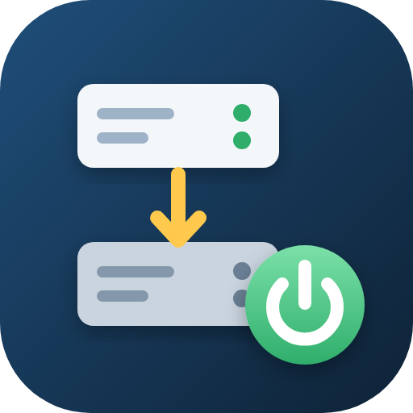

<p align="center"></p>

# Docker-TrueNAS_Backup

## Disclosure

This is a personal project, built with the help of AI (Claude) and reviewed and tested by me. It is not affiliated with or endorsed by iXsystems or the TrueNAS project. It powers a server on and off and starts ZFS replications, so read the docs and test it with `--no-shutdown` first. It comes with no warranty: use it at your own risk.

## What it is

One small container that runs on the **primary** TrueNAS and looks after a **backup** TrueNAS that is normally switched off. On a schedule (Mondays at 1:00 AM by default) it:

1. powers the backup box on with IPMI and/or Wake-on-LAN, whichever you have (in the order you choose),
2. waits for it to boot,
3. runs your existing replication task(s) through the primary's TrueNAS API and checks they finished,
4. shuts the backup box down cleanly through its own TrueNAS API and/or an IPMI soft power-off, and checks it is off,
5. tells Home Assistant how it went. A blueprint you import by URL pushes failures to your phone and warns you if a run never reports back.

```yaml
environment:
  TZ: America/New_York
  BACKUP_SCHEDULE: "0 1 * * mon"   # cron syntax
```

## Home Assistant alerts

[](https://my.home-assistant.io/redirect/blueprint_import/?blueprint_url=https%3A%2F%2Fgithub.com%2Fsoullink9%2FDocker-TrueNAS_Backup%2Fblob%2Fmain%2Fhomeassistant%2Ftruenas-backup.yaml)

Imports the alert blueprint from GitHub into Home Assistant 2026.11 or later. To import it from your own Gitea instead, see [Home Assistant](docs/home-assistant.md).

## Learn more

- [Setup](docs/setup.md): preparing both boxes, the API key, compose, every setting, running it by hand
- [Wake-on-LAN on an ASRock Rack X570D4U-2L2T](docs/wake-on-lan-x570d4u-2l2t.md): BIOS, the right port, and keeping WOL on in TrueNAS
- [Home Assistant](docs/home-assistant.md): the blueprint, phone alerts and the missed-run check
- [Development](docs/development.md): building, tests, versions and releases
- [Changelog](CHANGELOG.md): what changed in each release
